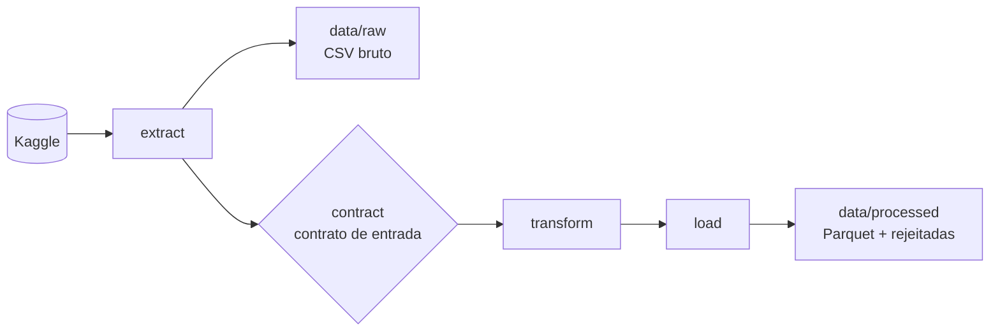
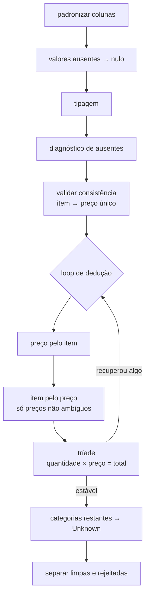

# 🧹 SalesFlow — ETL de Data Quality

Pipeline de dados em Python que extrai um dataset de vendas propositalmente sujo, **diagnostica e corrige** os problemas de qualidade e grava o resultado limpo em Parquet, separando as linhas irrecuperáveis com o motivo da rejeição.

O foco do projeto é **data quality e tratamento de erros**: cada correção é deduzida a partir de regras do próprio dado, sem imputação estatística e sem "chutar" valores. Cada etapa registra no log o que encontrou e o que fez, em números.

**Fonte:** [Cafe Sales — Dirty Data for Cleaning Training](https://www.kaggle.com/datasets/ahmedmohamed2003/cafe-sales-dirty-data-for-cleaning-training) (Kaggle)

---

## 📊 Resultados

| Métrica | Valor |
| --- | --- |
| Linhas na entrada | 10.000 |
| Linhas limpas | **9.974 (99,74%)** |
| Linhas rejeitadas | 26 (0,26%), com motivo registrado |
| Linhas perdidas no caminho | 0 |
| Valores recuperados por dedução | **1.951 de 2.483 (78,6%)** em item, quantidade, preço e total |
| Rodadas de dedução até estabilizar | 3 |
| Tempo de execução | ~1 s |

### Recuperação por coluna

| Coluna | Ausentes | Recuperados | Restantes | Destino dos restantes |
| --- | --- | --- | --- | --- |
| `item` | 969 | 489 | 480 | `Unknown` |
| `quantity` | 479 | 456 | 23 | rejeitados |
| `price_per_unit` | 533 | 527 | 6 | rejeitados |
| `total_spent` | 502 | 479 | 23 | rejeitados |

---

## 🔍 Problemas encontrados

O perfilamento mostrou que a sujeira vem em três formas de "valor desconhecido": **célula vazia, `ERROR` e `UNKNOWN`**. Nas colunas numéricas e de data, não existe nenhum outro tipo de valor inválido.

| Coluna | Valores ausentes | % |
| --- | --- | --- |
| `item` | 969 | 9,7% |
| `quantity` | 479 | 4,8% |
| `price_per_unit` | 533 | 5,3% |
| `total_spent` | 502 | 5,0% |
| `payment_method` | 3.178 | **31,8%** |
| `location` | 3.961 | **39,6%** |
| `transaction_date` | 460 | 4,6% |
| `transaction_id` | 0 | 100% único |

Outros achados que guiaram a limpeza:

- Nas 8.544 linhas com quantidade, preço e total válidos, `quantidade × preço = total` **sempre fecha**.
- Cada item tem **um único preço**, então a tabela de referência item → preço pode ser reconstruída a partir dos próprios dados.
- Dois preços são **ambíguos**: 3.0 (Cake ou Juice) e 4.0 (Sandwich ou Smoothie).
- Todas as datas válidas estão em 2023, no formato `AAAA-MM-DD`.

---

## 🏗️ Arquitetura



Dentro do `transform`:



---

## 🧠 Decisões de qualidade

A estratégia segue uma hierarquia: **deduzir → marcar como desconhecido → rejeitar**. Nenhum valor é preenchido com média ou moda.

| Situação | Tratamento | Justificativa |
| --- | --- | --- |
| Falta 1 valor da tríade | Calculado por `quantidade × preço = total` | Regra exata, validada em 100% das linhas completas |
| Quantidade calculada não inteira ou fora de 1–5 | Mantida vazia | Quantidade impossível é pior que quantidade ausente |
| Falta o preço, item conhecido | Preço da tabela de referência | Cada item tem preço único |
| Falta o item, preço conhecido | Item da referência **só se o preço for exclusivo** | 3.0 e 4.0 pertencem a dois itens; escolher um seria inventar |
| Item, pagamento ou local irrecuperáveis | `Unknown` | A venda é válida; preencher com a moda distorceria até 40% da coluna |
| Data ausente | Mantida vazia | A venda e o valor são confiáveis; só fica fora de análises por período |
| Tríade irrecuperável | **Rejeitada** com motivo | Sem quantidade, preço ou total, a linha não serve para análise financeira |

As deduções rodam em **loop até não recuperarem mais nada**, porque uma correção pode destravar outra: a tríade descobre o preço, e o preço descobre o item. Foram 21 valores recuperados só na segunda rodada.

---

## 🚨 Tratamento de erros

A pipeline distingue três níveis de erro:

| Nível | Exemplo | Comportamento | Código de saída |
| --- | --- | --- | --- |
| Pipeline | Falha no download, valor novo que não converte na tipagem, erro inesperado | Para e loga o traceback | `1` |
| Contrato | Dataset vazio, coluna faltando, `transaction_id` duplicado, item com dois preços | Lança `DataQualityError` e para | `2` |
| Linha | Venda com tríade irrecuperável | **Não para**: a linha é separada com o motivo | `0` |

A tipagem é feita **sem `errors="coerce"`**: o perfilamento provou que as únicas formas de sujeira são as três já tratadas, então qualquer valor novo que não converta indica mudança na origem, e a pipeline deve parar em vez de esconder o problema.

---

## 🧾 Log de execução

Cada etapa registra o que encontrou e o que fez:

```text
2026-10-14 15:44:23 | INFO     | salesflow            | SALESFLOW - Início da execução
2026-10-14 15:44:23 | INFO     | salesflow.extract    | Iniciando extração dos dados
2026-10-14 15:44:24 | INFO     | salesflow.extract    | Arquivo bruto: data.csv | 0.52 MB
2026-10-14 15:44:24 | INFO     | salesflow.extract    | Volume: 10000 linhas | 8 colunas

2026-10-14 15:44:24 | INFO     | salesflow.contract   | Iniciando validação de contrato
2026-10-14 15:44:24 | INFO     | salesflow.contract   | Schema OK: 8/8
2026-10-14 15:44:24 | INFO     | salesflow.contract   | Unicidade OK: transaction_id 10000/10000

2026-10-14 15:44:24 | INFO     | salesflow.transform  | Iniciando transformação dos dados
2026-10-14 15:44:24 | INFO     | salesflow.transform  | Diagnóstico
2026-10-14 15:44:24 | INFO     | salesflow.transform  | Tipagem OK: 4 colunas convertidas sem perda
2026-10-14 15:44:24 | INFO     | salesflow.transform  | Valores ausentes por coluna:
                   qtd     %
item               969   9.7
quantity           479   4.8
price_per_unit     533   5.3
total_spent        502   5.0
payment_method    3178  31.8
location          3961  39.6
transaction_date   460   4.6
2026-10-14 15:44:24 | WARNING  | salesflow.transform  | payment_method com 31.8% de valores ausentes
2026-10-14 15:44:24 | WARNING  | salesflow.transform  | location com 39.6% de valores ausentes
2026-10-14 15:44:24 | INFO     | salesflow.transform  | Recuperação por dedução
2026-10-14 15:44:24 | INFO     | salesflow.transform  | Consistência OK: cada item tem um único preço
2026-10-14 15:44:24 | INFO     | salesflow.transform  | Rodada 1: 1930 valores recuperados | 553 ausentes restantes
2026-10-14 15:44:24 | INFO     | salesflow.transform  | Rodada 2: 21 valores recuperados | 532 ausentes restantes
2026-10-14 15:44:24 | INFO     | salesflow.transform  | Rodada 3: 0 valores recuperados | 532 ausentes restantes
2026-10-14 15:44:24 | INFO     | salesflow.transform  | Recuperados por coluna:
                antes  recuperados  restantes
item              969          489        480
quantity          479          456         23
price_per_unit    533          527          6
total_spent       502          479         23
2026-10-14 15:44:24 | INFO     | salesflow.transform  | Total recuperado: 1951 de 2483 (78.6%)
2026-10-14 15:44:24 | INFO     | salesflow.transform  | Valores desconhecidos
2026-10-14 15:44:24 | INFO     | salesflow.transform  | Marcados como Unknown:
item               480
payment_method    3178
location          3961
2026-10-14 15:44:24 | INFO     | salesflow.transform  | Datas mantidas vazias: 460
2026-10-14 15:44:24 | INFO     | salesflow.transform  | Separação
2026-10-14 15:44:24 | INFO     | salesflow.transform  | Limpas: 9974 | Rejeitadas: 26
2026-10-14 15:44:24 | WARNING  | salesflow.transform  | Rejeitadas por motivo:
tríade irrecuperável    26

2026-10-14 15:44:24 | INFO     | salesflow.load       | Iniciando carregamento dos dados
2026-10-14 15:44:24 | INFO     | salesflow.load       | data/processed/sales.parquet: 9974 linhas
2026-10-14 15:44:24 | INFO     | salesflow.load       | data/processed/sales_rejected.csv: 26 linhas
2026-10-14 15:44:24 | INFO     | salesflow            | SALESFLOW - Fim da execução
```

---

## 📁 Estrutura do Projeto

```text
salesflow/
├── data/
│   ├── raw/
│   │   └── data.csv              # Cópia do CSV bruto, lido como texto
│   └── processed/
│       ├── sales.parquet         # Dado limpo, com tipos preservados
│       └── sales_rejected.csv    # Linhas rejeitadas + motivo
├── src/salesflow/
│   ├── __init__.py
│   ├── extract.py                # Download do Kaggle e leitura sem interpretação
│   ├── contract.py               # Contrato de entrada e DataQualityError
│   ├── transform.py              # Diagnóstico, dedução e separação
│   └── load.py                   # Gravação em Parquet e CSV
├── main.py                       # Orquestração, logging e códigos de saída
├── pyproject.toml
└── uv.lock
```

---

## ⚙️ Tecnologias Utilizadas

| Tecnologia | Uso |
| --- | --- |
| Python 3.14 | Linguagem principal |
| pandas 3 | Diagnóstico, transformação e validação |
| PyArrow | Gravação em Parquet |
| kagglehub | Download do dataset |
| uv | Gerenciamento de ambiente e dependências |
| logging | Registro das métricas de qualidade de cada etapa |

---

## 🚀 Como Executar

### Pré-requisitos

- [uv](https://docs.astral.sh/uv/) instalado

### 1. Clone o repositório

```bash
git clone https://github.com/RodriguesGS/salesflow.git
cd salesflow
```

### 2. Instale as dependências

```bash
uv sync
```

### 3. Rode a pipeline

```bash
uv run main.py
```

O dataset é baixado automaticamente do Kaggle na primeira execução e fica em cache nas seguintes.

---

## 🔄 Detalhes do Pipeline

### `extract.py`

- Baixa o dataset com `kagglehub`
- Lê **todas as colunas como texto** e sem conversão automática de vazios em `NaN`, preservando o dado exatamente como veio
- Salva a cópia bruta em `data/raw/`
- Registra tamanho do arquivo e volume

### `contract.py`

- Define `DataQualityError`, usada para violações que impedem a pipeline de continuar
- `check_raw`: barra dataset vazio, colunas faltando (informando quais) e `transaction_id` duplicado

### `transform.py`

- **Padronização:** renomeia colunas para `snake_case` por dicionário (não por posição) e converte `""`, `ERROR` e `UNKNOWN` em nulo real
- **Tipagem:** `Int64`, `float64` e `datetime64`, sem `errors="coerce"`
- **Diagnóstico:** ausentes por coluna, com alerta acima de 10%
- **Consistência:** monta a referência item → preço a partir dos dados e falha se algum item tiver mais de um preço
- **Dedução:** recupera valores pela referência e pela tríade, em loop até estabilizar
- **Desconhecidos:** preenche categorias irrecuperáveis com `Unknown` e mantém datas ausentes vazias
- **Separação:** divide limpas e rejeitadas, com a coluna `reject_reason`

### `load.py`

- Grava o dado limpo em Parquet, preservando os tipos
- Grava as rejeitadas em CSV, para inspeção manual

### `main.py`

- Orquestra as etapas e configura o logging
- Diferencia falha de contrato (código 2) de falha técnica (código 1)

---

## 🗺️ Próximos Passos

- [ ] Contrato de saída: unicidade, domínios e tríade validados no dado final
- [ ] Métricas de qualidade de cada execução salvas em JSON
- [ ] Colunas de linhagem indicando quais valores foram deduzidos
- [ ] Testes com `pytest` para as regras de dedução
- [ ] Orquestração com Apache Airflow

---

## 📄 Licença

Este projeto está sob a licença MIT. Consulte o arquivo `LICENSE` para mais detalhes.